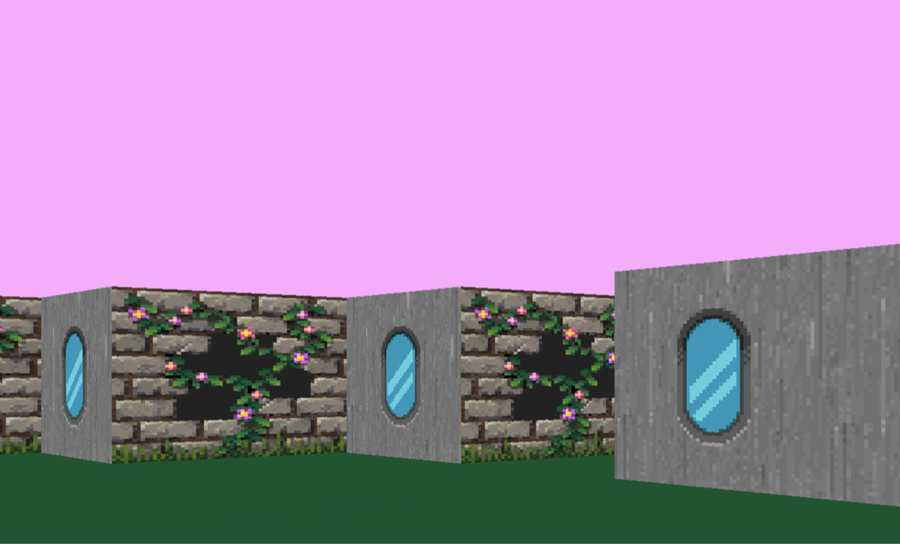
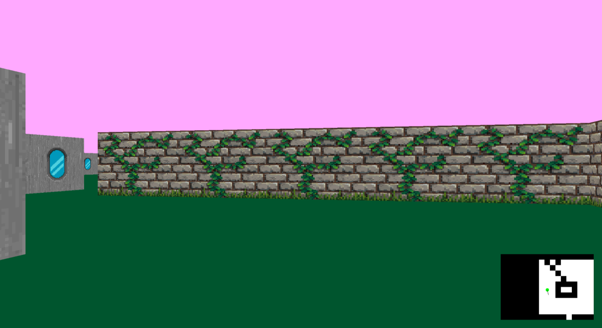

*This project has been created as part of the 42 curriculum by chpasqui, sydubois.*

<div align="center">

# cub3D

**A first-person 3D maze rendered with raycasting, in C, with the MiniLibX.**
Inspired by Wolfenstein 3D, the first FPS ever made.


 

</div>

## Description

cub3D turns a 2D map into a 3D view. For every column of the screen, a ray is cast from the player through the map until it hits a wall; the distance to that wall gives the height of the vertical strip to draw. No 3D engine, only maths and pixels.

- **Textured walls**, with a different texture for each cardinal direction (North, South, East, West).
- **Floor and ceiling colors** set in the map file.
- **Smooth movement and rotation**, with several keys held at the same time.
- **Minimap** showing the player in the map.
- **Strict map parsing**: any invalid file is rejected with a clear error message.

## Instructions

### Build

```bash
make
```

The Makefile detects the system: it uses `minilibx-linux` on Linux and `minilibx_opengl` on macOS. Both are included in the repository.

### Run

```bash
./cub3d maps/map1.cub
```

### Controls

| Key | Action |
|---|---|
| `W` / `Up` | Move forward |
| `S` / `Down` | Move backward |
| `A` | Move left |
| `D` | Move right |
| `Left` / `Right` | Turn left / right |
| `Esc` or window cross | Quit |

### Map format (`.cub`)

```
NO textures/north.xpm
SO textures/south.xpm
WE textures/west.xpm
EA textures/east.xpm
F 0,85,46
C 255,169,255

11111111
10000001
100N0001
11111111
```

- `NO`, `SO`, `WE`, `EA`: path to the `.xpm` texture of each wall side.
- `F` and `C`: floor and ceiling colors, in `R,G,B` (0 to 255).
- The map comes last. `1` is a wall, `0` an empty space, and exactly one of `N`, `S`, `E`, `W` gives the player's start position and direction. Spaces are allowed outside the playable area.
- The map must be **closed** by walls.

The `maps/` folder contains valid maps and invalid ones (`bad_map.cub`, `too_big.cub`) to see the error handling.

## How it works

| Step | What happens |
|---|---|
| **Parsing** | The file is read, the six identifiers are checked (no missing, no duplicate, valid colors), then the grid is saved. |
| **Validation** | A depth-first search from the player makes sure the map is closed: if it can reach the edge or a void, the map is rejected. |
| **Raycasting** | For each screen column, a ray is cast with the **DDA** algorithm (Digital Differential Analyzer), which jumps from one grid line to the next until it hits a wall. |
| **Rendering** | The distance (corrected to avoid the fisheye effect) gives the wall height; the right texture column is drawn, with ceiling and floor above and below. |
| **Events** | Key presses and releases are stored, then applied at every frame, so movement and rotation are smooth. |

### Code organization

```
src/
├── parsing/       .cub file: identifiers, colors, grid, closed-map check
├── init/          game, window, textures, colors, player
├── raycasting/    ray setup and DDA
├── rendering/     walls, floor and ceiling, minimap, logo
├── events/        keys and movement
└── utils/
includes/          headers (structures, errors, colors, keycodes)
libft/             our own C library
```

## Resources

- [Lode's Computer Graphics Tutorial: Raycasting](https://lodev.org/cgtutor/raycasting.html), the main reference for DDA and texture mapping.
- [Player direction vector and camera vector](https://hackmd.io/@nszl/H1LXByIE2#player-direction-vector-and-camera-vector)
- [MiniLibX documentation](https://harm-smits.github.io/42docs/libs/minilibx)

## Authors

Made by [chpasqui](https://github.com/chpasqui) and sydubois.
